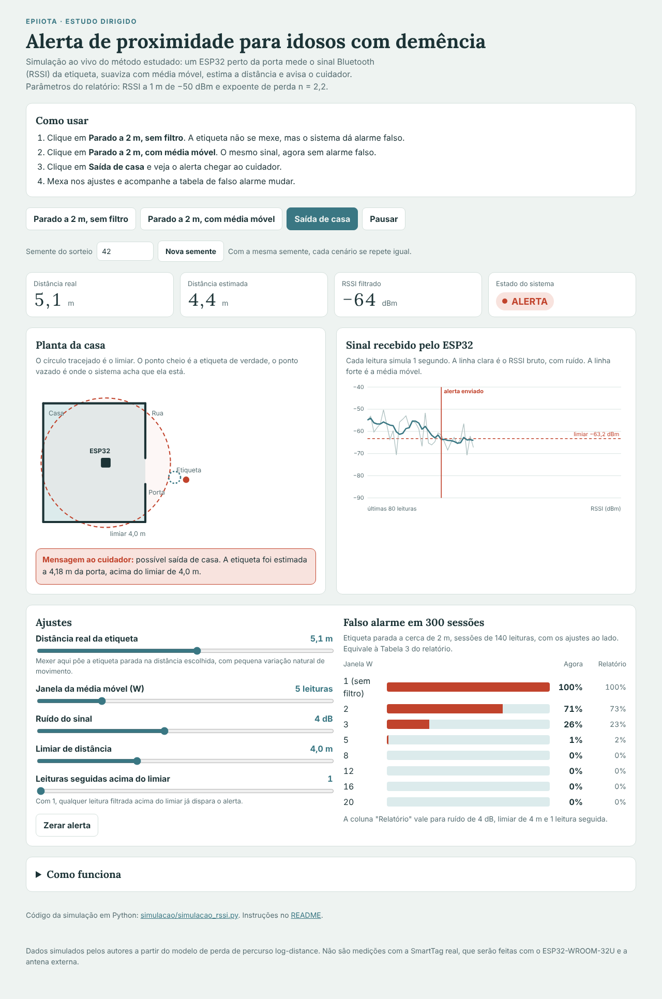

# Alerta de proximidade por RSSI em BLE para idosos com demência

Estudo dirigido da disciplina **EPIIOTA, Internet das Coisas** (Unesp).
Autores: Alec Shinohara Hildinger e Kevin Seiji Maeda.

Um idoso com demência pode sair de casa sem acompanhamento. Os localizadores GPS têm fronteira grossa demais para detectar a saída de uma única casa. Este projeto propõe algo mais simples: **um ESP32 perto da porta escuta o sinal Bluetooth Low Energy (BLE) de uma etiqueta Samsung SmartTag, estima a distância pela intensidade do sinal (RSSI), suaviza as leituras com média móvel e avisa o cuidador por MQTT** quando a etiqueta passa de um limiar.



## Demonstração interativa

Abra o `index.html` no navegador, ou acesse a página publicada:

`https://heymoonshaker.github.io/alerta-proximidade-iot/`

Na página, clique nos três cenários (parado a 2 m sem filtro, parado a 2 m com média móvel, saída de casa) e mexa nos ajustes. A tabela de falso alarme é recalculada a cada mudança. Funciona sem instalar nada.

## Simulação em Python

Gera as figuras e a tabela de falso alarme do relatório.

```bash
cd simulacao
pip install -r requirements.txt
python simulacao_rssi.py
```

Os arquivos vão para a pasta `saidas/`. Algumas opções:

| Opção | Significado | Padrão |
|---|---|---|
| `--seed` | semente do sorteio (mesma semente, mesmo resultado) | 42 |
| `--sigma` | ruído do sinal nos testes, em dB | 4 |
| `--limiar` | limiar de distância, em metros | 4 |
| `--janelas` | tamanhos de janela da média móvel a testar | 1 2 3 5 8 12 16 20 |
| `--repeticoes` | sessões simuladas por janela | 300 |
| `--saida` | pasta de saída | `saidas` |

Exemplo: `python simulacao_rssi.py --sigma 6 --seed 7 --janelas 1 5 10`

### Resultado com os parâmetros padrão (semente 42)

Etiqueta parada a cerca de 2 m, 300 sessões de 140 leituras por janela:

| Janela W | 1 | 2 | 3 | 5 | 8 | 12 | 16 | 20 |
|---|---|---|---|---|---|---|---|---|
| Falso alarme | 100% | 71% | 27% | 1% | 0% | 0% | 0% | 0% |

Sem filtro, o ruído sozinho dispara o alarme em todas as sessões. Com média móvel de 5 a 8 leituras, o falso alarme cai a perto de zero. Com outra semente os percentuais variam alguns pontos, e a conclusão se mantém.

## O modelo

```
RSSI(d) = RSSI0 - 10 · n · log10(d) + ruído
d_est   = 10 ^ ((RSSI0 - RSSI) / (10 · n))
```

Parâmetros adotados: RSSI0 = −50 dBm a 1 m, n = 2,2, ruído normal de 4 dB, limiar de 4 m (cerca de −63,2 dBm).

## Limitações

- **Os dados são simulados.** Os resultados mostram o comportamento esperado do método e não substituem medições com o hardware real.
- Os parâmetros do modelo dependem do ambiente e precisam ser calibrados na casa onde o sistema for instalado.
- A SmartTag usa endereços privados que mudam com o tempo, e o comportamento do anúncio longe do celular do dono precisa ser verificado.
- Próximos passos: medições com o ESP32-WROOM-32U com antena externa e a SmartTag, MQTT e notificação ao cuidador.

## Estrutura

```
index.html                    demonstração interativa
simulacao/simulacao_rssi.py   simulação em Python
simulacao/requirements.txt    dependências
saidas/                       figuras e tabela geradas com os parâmetros padrão
docs/demonstracao.png         captura da demonstração
```

## Nota sobre o desenvolvimento

O código da simulação e da demonstração foi desenvolvido com apoio de uma ferramenta de IA (Claude, da Anthropic), com base no modelo e nos parâmetros definidos pelos autores para o estudo dirigido.

## Licença

MIT. Veja o arquivo `LICENSE`.
