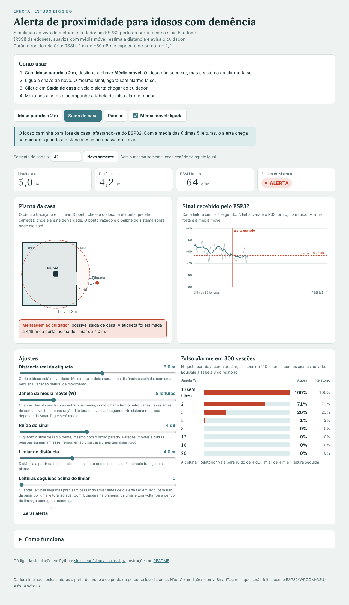

# Alerta de proximidade por RSSI em BLE para idosos com demência

Estudo dirigido da disciplina **EPIIOTA, Internet das Coisas** (Unesp).
Autores: Alec Shinohara Hildinger e Kevin Seiji Maeda.

Um idoso com demência pode sair de casa sem acompanhamento. Os localizadores GPS têm fronteira grossa demais para detectar a saída de uma única casa. Este projeto propõe algo mais simples: **um ESP32 perto da porta escuta o sinal Bluetooth Low Energy (BLE) de uma etiqueta Samsung SmartTag, mede a intensidade do sinal (RSSI), acumula evidência de que a etiqueta se afastou e avisa o cuidador pelo Telegram** quando o sinal fica mais fraco que um limiar definido no local, ou some de repente. A demonstração e a simulação abaixo usam média móvel; o firmware usa a evidência acumulada descrita na seção do firmware.



## Demonstração interativa

Abra o `index.html` no navegador, ou acesse a página publicada:

`https://heymoonshaker.github.io/alerta-proximidade/`

Na página, use os botões "Idoso parado a 2 m" e "Saída de casa", ligue e desligue a chave "Média móvel" para ver o antes e o depois, e mexa nos ajustes. A tabela de falso alarme é recalculada a cada mudança. Funciona sem instalar nada.

## Como usar os ajustes

- **Distância real:** onde o idoso está de verdade. É o ponto cheio na planta.
- **Janela da média móvel (W):** quantas das últimas leituras entram na média antes da decisão. Na demonstração, 1 leitura equivale a 1 segundo. No sistema real, depende da SmartTag e será medido.
- **Ruído do sinal:** o quanto o RSSI treme, mesmo com o idoso parado. Casas com mais paredes e móveis têm mais ruído.
- **Limiar de distância:** a partir de quanto o sistema considera que o idoso saiu. É o círculo tracejado.
- **Leituras seguidas:** quantas leituras seguidas acima do limiar são exigidas antes do alerta. Evita disparar por uma leitura isolada, ao custo de um pequeno atraso.

O ponto vazado na planta é o palpite do sistema sobre onde o idoso está. Quando ele se afasta do ponto cheio, o ruído está enganando o sistema.

## Simulação em Python

Gera as figuras e a tabela de falso alarme do relatório.

```bash
cd simulacao
pip install -r requirements.txt
python simulacao_rssi.py
```

Os arquivos vão para a pasta `saidas/`. Algumas opções:

| Opção | Significado | Padrão |
|---|---|---|
| `--seed` | semente do sorteio (mesma semente, mesmo resultado) | 42 |
| `--sigma` | ruído do sinal nos testes, em dB | 4 |
| `--limiar` | limiar de distância, em metros | 4 |
| `--janelas` | tamanhos de janela da média móvel a testar | 1 2 3 5 8 12 16 20 |
| `--repeticoes` | sessões simuladas por janela | 300 |
| `--saida` | pasta de saída | `saidas` |

Exemplo: `python simulacao_rssi.py --sigma 6 --seed 7 --janelas 1 5 10`

### Resultado com os parâmetros padrão (semente 42)

Etiqueta parada a cerca de 2 m, 300 sessões de 140 leituras por janela:

| Janela W | 1 | 2 | 3 | 5 | 8 | 12 | 16 | 20 |
|---|---|---|---|---|---|---|---|---|
| Falso alarme | 100% | 71% | 27% | 1% | 0% | 0% | 0% | 0% |

Sem filtro, o ruído sozinho dispara o alarme em todas as sessões. Com média móvel de 5 a 8 leituras, o falso alarme cai a perto de zero. Com outra semente os percentuais variam alguns pontos, e a conclusão se mantém.

## Firmware do ESP32 (protótipo real)

Pasta `firmware/alerta_smarttag_rede/`. Roda no ESP32-WROOM-32U (antena externa) e escuta passivamente a SmartTag por BLE. O firmware é a versão 6.1.

**Como usar**

1. Na Arduino IDE, instale o suporte à placa ESP32 (núcleo 3.x) e escolha *ESP32 Dev Module*. Em *Tools > Partition Scheme*, escolha **Huge APP (3MB No OTA/1MB SPIFFS)**.
2. Copie `segredos.exemplo.h` para `segredos.h` (mesma pasta) e preencha o Wi-Fi (2,4 GHz), o token do bot (BotFather) e o chat id. O `segredos.h` está no `.gitignore`: **nunca suba o token**. O MQTT é opcional (`USAR_MQTT 0` dispensa a biblioteca PubSubClient).
3. Carregue o `alerta_smarttag_rede.ino` e abra o Serial Monitor em **115200**.
4. Encoste a tag perto da antena até aparecer `TRAVADO na tag ...`. Leve a tag a um ponto **um ou dois passos antes do portão** (não em cima da linha), espere umas 20 leituras e digite `l`. O programa mostra o valor; copie-o para `LIMIAR_FIXO_DBM` no código e envie de novo, assim o limiar sobrevive a reinícios.
5. Digite `t` para conferir se a mensagem de teste chega ao Telegram.

**Comandos no Serial Monitor**

| Comando | O que faz |
|---|---|
| `l` | usa o sinal médio atual como limiar de alerta (tag no ponto onde deve alertar) |
| `p` | passeio: ande com a tag pela casa por 1 a 2 min e digite `p` de novo; mostra a faixa de sinal dentro de casa para comparar com o limiar |
| `i` | mostra o estado: tag, nível, limiar, evidência, Wi-Fi, memória livre (e a mínima já vista) e pilha livre |
| `r` | destrava da tag |
| `t` | envia uma mensagem de teste ao Telegram |
| `h` | ajuda |

**Como o alerta é decidido**

- A decisão é em **dBm**, não em metros. Converter RSSI em distância erra bastante dentro de casa.
- **Evidência acumulada.** Cada leitura mais fraca que o limiar (menos `FOLGA_DB` = 2 dB) soma pontos, até 12 por leitura; leituras boas subtraem, e a pontuação nunca fica abaixo de zero. Ao chegar em `EVID_ALERTA` = 35, dispara "Idoso afastou-se do perímetro seguro". Uma leitura ruim isolada não alerta, e uma saída de verdade (várias leituras fracas seguidas) alerta em cerca de 10 s.
- **Silêncio.** Se a tag deixa de aparecer, depois de 3 s o silêncio também soma pontos a cada 2 s: 12 se o último sinal estava a menos de 4 dB do limiar, 8 se a menos de 10 dB, 4 se estava forte. Há um teto absoluto de 20 s sem leitura. Se o sinal sumiu perto do limiar, a mensagem é a de saída do perímetro; se sumiu com o sinal ainda forte, é "Sinal interrompido (Tag fora de alcance/parede)".
- **Fim do alerta.** O alerta só termina quando a mediana das últimas 5 leituras passa 5 dB acima do limiar (histerese). Enquanto durar, a mensagem se repete a cada 2 min.
- **Anti-spam do silêncio.** O primeiro "sinal interrompido" avisa na hora. Se outro vier em menos de 10 min, a mensagem só sai se o silêncio durar 45 s seguidos; se o sinal voltar antes, nada é enviado.
- **Troca de MAC.** A SmartTag troca de endereço de tempos em tempos. O programa aceita o endereço novo depois de 3 s sem o antigo, se o sinal novo for compatível com o anterior.
- **Travada na tag.** Trava na primeira tag com serviço FD5A que apareça pelo menos 3 dB acima do limiar. Se nenhuma aparecer em 90 s, avisa no Telegram que o monitoramento não está ativo (e repete a cada 30 min). O programa não distingue duas SmartTags: com duas por perto, pode travar na errada.
- **Fila de mensagens.** Se o Wi-Fi ou o Telegram falharem, a mensagem fica na fila e é reenviada (até 10 tentativas, a cada 10 s). A mensagem "ESP32 Online." informa o motivo do último reinício (energia, fonte fraca, erro do programa etc.).

**Ajustes mais comuns** (constantes no início do `.ino`)

| Constante | Padrão | Efeito |
|---|---|---|
| `LIMIAR_FIXO_DBM` | -68 | nível do ponto onde o alerta deve disparar; calibre no local com `l` |
| `EVID_ALERTA` | 35 | 25 = mais rápido e mais falsos alarmes; 45 = mais cauteloso |
| `FOLGA_DB` | 2 | quanto abaixo do limiar uma leitura precisa estar para somar |
| `SEM_SINAL_MS` | 20000 | limite absoluto de silêncio |
| `REDE_EM_TAREFA` | 0 | 0 = rede no `loop()` (menos memória; a varredura pausa alguns segundos a cada envio). 1 = rede em tarefa própria (a varredura nunca pausa, mas gasta uns 8 KB a mais) |

**Memória.** A conexão segura com o Telegram precisa de cerca de 50 KB de heap livre de uma vez. Na primeira versão com tarefa de rede própria, a memória mínima chegou a 5 KB e o envio falhava com `HTTP -1`. Use o comando `i` depois de um envio para conferir a memória mínima da sua placa antes de ligar `REDE_EM_TAREFA`.

**Comparação com o código anterior (simulação).** Os mesmos fluxos de leituras sintéticas foram aplicados ao `.ino` anterior do projeto (silêncio de 10 s) e ao atual, os dois compilados e executados no PC. O ruído foi 4,5 dB por leitura, com variação lenta do sinal e troca de MAC a cada 15 min onde indicado. São números de simulação com ruído escolhido por nós; não substituem o teste no local.

| Falsos alarmes por hora, tag parada | Anterior | Atual |
|---|---|---|
| tag 3 dB acima do limiar | 30,4 | 5,5 |
| tag 6 dB acima do limiar | 12,6 | 0,8 |
| tag 9 dB acima do limiar | 3,1 | 0,15 |
| 9 dB + falhas de recepção | 4,2 | 0,9 |
| 6 dB + troca de MAC a cada 15 min | 15,8 | 0,8 |

| Atraso até o alerta depois de cruzar o limiar (mediana) | Anterior | Atual |
|---|---|---|
| saída rápida (3,6 dB/s) | 14,5 s | 9,5 s |
| saída lenta (1,5 dB/s) | 11,5 s | 10,8 s |
| corte brusco partindo de 3 dB acima | 8,9 s | 6,6 s |
| corte brusco partindo de 8 dB acima | 9,1 s | 10,7 s |

O único caso pior que o anterior é o corte brusco partindo de longe do limiar (10,7 s contra 9,1 s). Os scripts que geraram essas duas tabelas (comparação com o `.ino` antigo) não estão neste repositório. Os testes do firmware atual estão em `testes/`.

**Testes no PC.** A pasta `testes/` roda o próprio `.ino` com Bluetooth, Wi-Fi, Telegram e relógio simulados, em 29 cenários (saída gradual, corte brusco, troca de MAC, Telegram fora do ar, envio lento, sinal oscilando no limite, volta do contador de tempo etc.), com AddressSanitizer e UBSanitizer. Veja `testes/LEIAME.md`. Isso valida a lógica; o rádio real e a memória só se confirmam na placa.

**Demonstração ao vivo: a mesma simulação na placa e no Git.** Dois cenários (tag parada dentro por 3 min, sem alerta; e sair pelo portão e voltar, com alerta e normalização) rodam no PC com `./testes/demo.sh` e são refeitos na placa com a SmartTag. O roteiro, o resultado esperado e como conferir que o código é o mesmo estão em `docs/demonstracao_ao_vivo.md`.

**O que foi medido na bancada** (um ambiente, uma SmartTag; não é validação estatística; medido com uma versão anterior do firmware, que tinha o comando de calibração em metros, hoje removido)

- Com a tag parada a 2,2 m e sem obstáculo, a média de 20 leituras ficou estável em torno de -60,2 dBm (variação de ±0,5 dB). As leituras brutas variam cerca de 4,5 dB, compatível com o ruído de 4 dB da simulação.
- Calibração em linha reta com 4 pontos: RSSI0 = -45,3 dBm e n = 3,01. Trena contra estimativa: 1,00 m (1,01), 2,00 m (2,01), 3,00 m (2,83) e 4,00 m (4,18).
- Fora dessa linha o erro cresce: em outros pontos da sala a estimativa chegou a errar por mais de 1 m, por causa de reflexões e obstáculos. Por isso a decisão do alarme usa o limiar em dBm, e não a distância em metros.
- A mensagem de teste (`t`) chegou ao Telegram. Os testes de travessia da porta e de falso alarme no local definitivo ainda serão feitos.

## O modelo

```
RSSI(d) = RSSI0 - 10 · n · log10(d) + ruído
d_est   = 10 ^ ((RSSI0 - RSSI) / (10 · n))
```

Parâmetros adotados na simulação: RSSI0 = −50 dBm a 1 m, n = 2,2, ruído normal de 4 dB, limiar de 4 m (cerca de −63,2 dBm). No firmware, os valores medidos na bancada foram RSSI0 = −45,3 dBm e n = 3,01.

## Limitações

- **Os resultados da simulação são sintéticos.** Eles mostram o comportamento esperado do método. As medições com o hardware real (seção do firmware) foram feitas em um ambiente e com uma tag, e não substituem testes de travessia e de falso alarme na casa de uso.
- Os parâmetros do modelo dependem do ambiente e precisam ser calibrados na casa onde o sistema for instalado.
- A SmartTag usa endereços privados que mudam com o tempo, e o comportamento do anúncio longe do celular do dono precisa ser verificado.
- A estimativa em metros não é confiável fora da linha em que foi calibrada. O alarme usa o limiar em dBm definido no local.
- O limiar não é gravado na memória flash pelo comando `l`: o valor é copiado para `LIMIAR_FIXO_DBM` no código. A travada na tag é refeita sozinha a cada reinício. A conexão ao Telegram usa `setInsecure()` (não valida o certificado) e o MQTT público é aberto. São aceitáveis para o protótipo, não para uso real.
- A decisão é por nível de sinal: uma falha de recepção com a tag ainda dentro pode virar "sinal interrompido", e uma saída que some atrás de um obstáculo pode sair como mensagem de silêncio. O anti-spam reduz as repetições, mas não elimina o falso aviso isolado.
- Próximos passos: testes de travessia e de falso alarme no local definitivo, gravar o limiar na memória flash e validar com mais de uma tag.

## Estrutura

```
index.html                    demonstração interativa
simulacao/simulacao_rssi.py   simulação em Python
simulacao/requirements.txt    dependências
firmware/alerta_smarttag_rede/
  alerta_smarttag_rede.ino    firmware do ESP32 (BLE + Telegram, versão 6.1)
  segredos.exemplo.h          modelo da configuração (copie para segredos.h)
testes/                       testes do firmware no PC (harness, stubs, rodar_testes.sh e demo.sh)
saidas/                       figuras e tabela geradas com os parâmetros padrão
docs/demonstracao.png         captura da demonstração
docs/demonstracao_ao_vivo.md  roteiro para refazer os mesmos dois cenários na placa e no PC
```

## Nota sobre o desenvolvimento

O código da simulação, da demonstração e do firmware foi desenvolvido com apoio de uma ferramenta de IA (Claude, da Anthropic), com base no modelo e nos parâmetros definidos pelos autores para o estudo dirigido.

## Licença

MIT. Veja o arquivo `LICENSE`.
